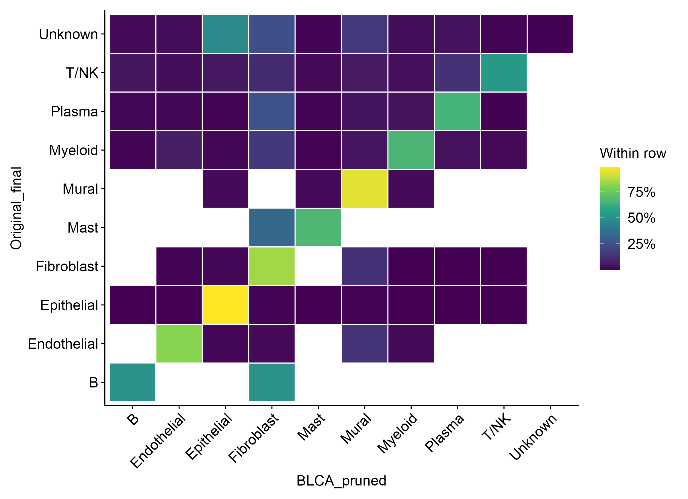
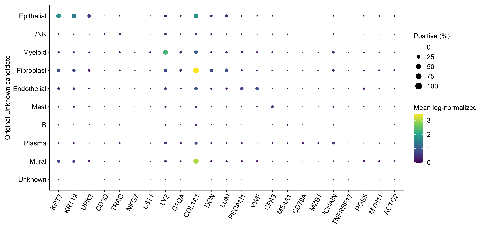
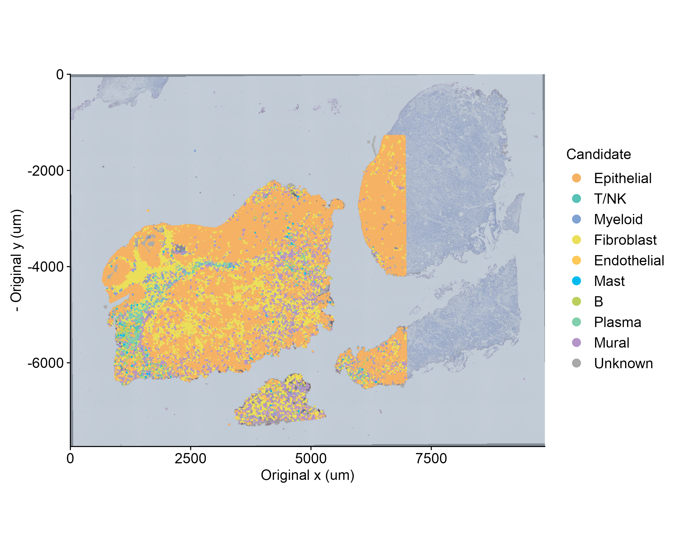
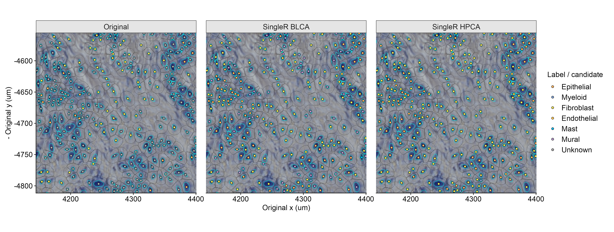
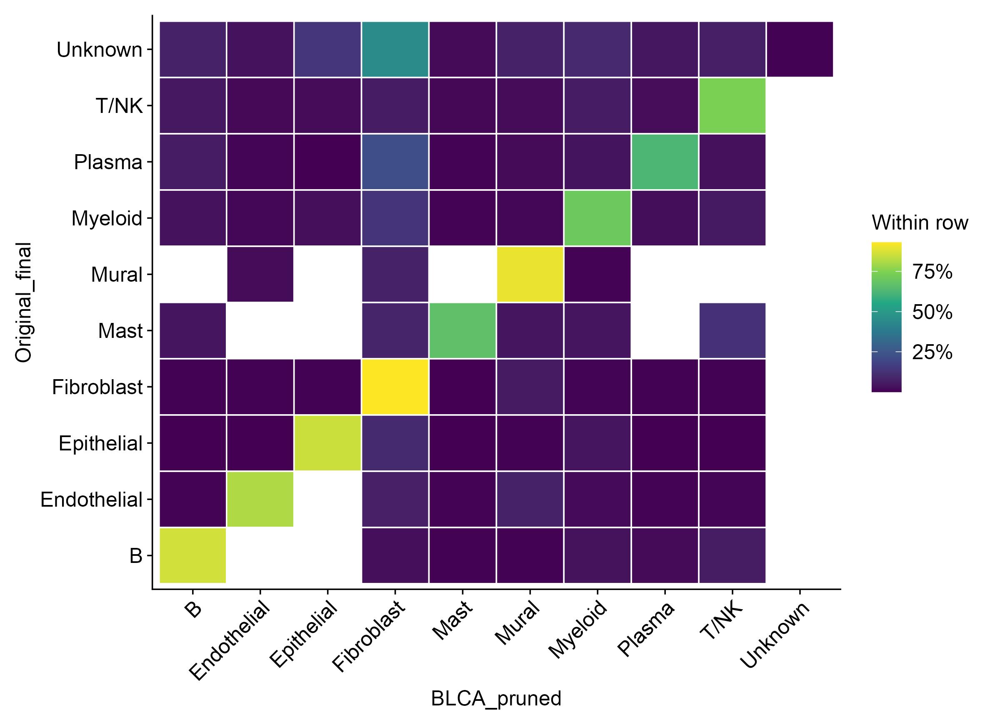
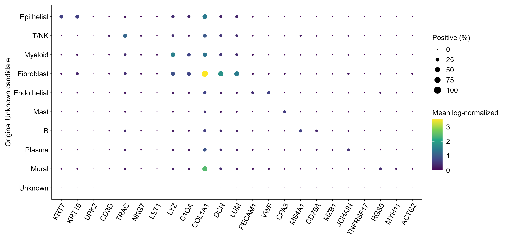
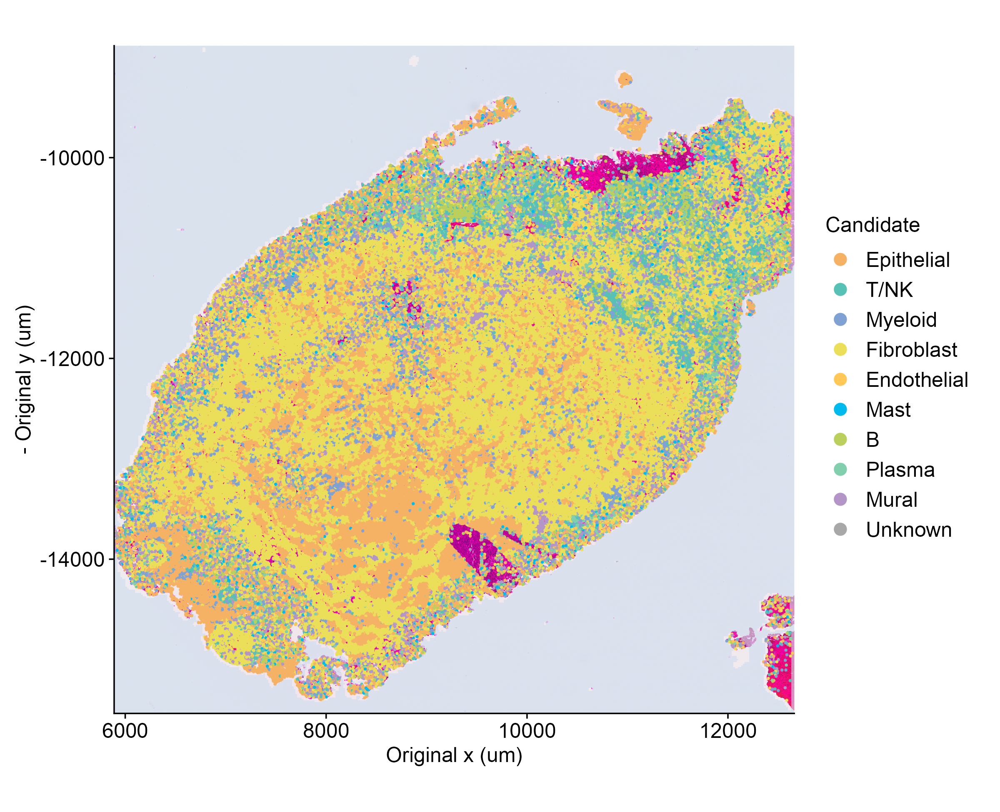
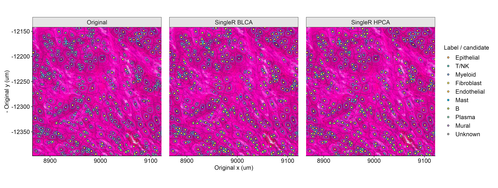
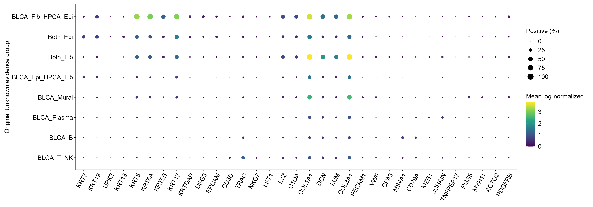

# Unknown 来源诊断与 SingleR 对照


更新：2026-11-07T11:59:55 (服务器本地时间)。两片全部原 qc_keep_analysis 对象已完成；本轮候选不替换原正式注释。


结果根目录：`/home/data/t070721/codex_workspace/Bladder Metabolism/highres_VisiumHD/analysis/hd_annotation_diagnosis_singler_v1`。主输入位于 `../hd_major_annotation_v1/<section>/seurat.rds`；预处理保持 `../segmentation_assignment_v2/`。


| section | n | UMI | original_unknown | unknown_UMI | unknown_BLCA_nonpruned | unknown_HPCA_nonpruned | unknown_both_agree | unknown_both_disagree | unknown_neither_nonpruned |
|---|---|---|---|---|---|---|---|---|---|
| Cervilla | 93593 | 60670091 | 47340 | 19317643 | 47275 | 46855 | 29922 | 16892 | 24 |
| D1_Johnson | 188237 | 127719635 | 125319 | 62683576 | 124985 | 124053 | 61860 | 61946 | 87 |


一致数仅作描述，不设“两方法一致”的新接纳门槛。未被 pruning 的候选也不等于高置信度或已救回身份。


## 原规则追踪与主要结论


原 Seurat 使用冻结 BLCA 44,896 个参考细胞，训练前已归并为九大类，直接 TransferData 大类预测；并非细亚型先预测再归并。原脚本没有调用 GetTransferPredictions，因此不存在实际 score.filter，也不是被其默认 0.75 截断。原始预测均有类别，Unknown 产生于随后 marker/一致性规则。

主接纳要求逐对象：(1) marker 强度最大谱系与参考原预测一致；(2) 预测谱系至少检出两枚 panel marker；(3) 不触发跨谱系竞争。竞争定义为至少两组各检出≥2枚且强度≥最强组的70%，仅 Fibroblast+Mural 共同收缩表达时豁免。Plasma 另要求 MZB1/JCHAIN/TNFRSF17/DERL3 至少一个 core marker，否则其 panel 证据置零。该竞争指标是诊断规则，不是已验证的混合细胞或双细胞真值。

参考支持带取 marker 一致且 nFeature≥30 对象的类内分数/分差第10百分位，稀少类用合并分布；主要决定 supported 与 low_confidence。主接纳对象即使低于带仍有暂定标签。另有“一枚 marker + 强参考支持 + 簇参考一致率≥0.8”的低置信度补充，以及至少两枚对象 marker 和两枚 cluster-enriched marker 的低置信度参考不匹配修订。原未通过 marker 一致性和数量规则的对象，不能简单归因于参考置信阈值。

原 marker 计算使用完整分析集合的 RNA 原始 counts 检出与 RNA LogNormalize data 强度；不是 sketch、HVG 或 scale.data。两片全部标签、置信状态与冲突标志已根据原代码和缓存精确重现。原 annotation_reason 为历史记录；diag_first_rejection_reconstructed 按书写的合取顺序“谱系一致→数量→冲突”重建，仅对最终 Unknown 赋值。矢量代码没有历史短路执行日志，故不将此字段冒充原始运行日志。原 reason 的赋值覆盖顺序与首次失败不同。

共有基因总体匹配正常，但BLCA共有panel缺KRT18及Mast的TPSAB1/TPSB2；HPCA还缺KRT8、TRBC2及部分免疫球蛋白基因。覆盖不足是具体局限，不能称所有marker完整。原RNA的完整panel统计用于独立复核这些候选。

原报告区分了支持性 marker 不足和竞争，但两者都会产生 Unknown。关闭单规则的结果只评估敏感性，保持原支持带不变，不自动改正式标签。重叠规则不能直接相加。


## 两路 SingleR 设置与适用范围


固定 seed=123，SingleR 2.12.0；4 个计算线程，BLAS 1，逐片处理，query 每块最多5,000对象。每个切片×参考的 classifySingleR(prune=FALSE) 结果按 cell_id 合并后仅统一调用一次默认 pruneScores(nmads=3,min.diff.med=-Inf,min.diff.next=0)。验证时由保存的完整 scores、labels、delta.next 再现全片 pruning。scores 是 fine-tuning 前相关性分数，不是概率；其最大分列可能不同于最终 labels。保留官方 delta.next 与相对中位数 delta，未以普通 top1−top2 代替。

BLCA：完全复用原参考缓存的44,896细胞及标签；9类均覆盖，14,325个可靠共有 Ensembl 基因。trainSingleR(de.method="wilcox",de.n=50,aggr.ref=TRUE)，查询仍逐对象，非簇级。其与原 Seurat 的一致性是同参考下的方法稳健性证据，不是独立准确率验证。原参考来源与细标签到大类映射见 reference/blca_label_mapping.tsv；原 reference.rds 保留在上一轮。

HPCA：celldex::HumanPrimaryCellAtlasData()，隔离安装的 celldex 1.12.0，ExperimentHub HPCA 1.0.0 (EH3492/3508 logcounts)，复用官方下载缓存。网络中断通过断点续传恢复，无替换或合成参考。作者指定10个 label.main 子集共448样本，训练前映射到6大类；19,363参考基因中15,916与HD symbol共有。trainSingleR(de.method="classic",aggr.ref=FALSE)。不覆盖 Mast、Plasma、Mural；这些 BLCA 候选的 HPCA 分歧须单列，不能解读为类型不存在或成功救回。作者代码对部分T/B使用细标签，本轮按大类；本轮是重建细胞的RNA对照，并非8um方格+SCT的严格复现。

查询来自完整18,085基因 RNA LogNormalize data；没有额外QC、HVG限制或重新整合。BLCA按Ensembl ID匹配。HPCA临时视图将TBCE、HSPA14、TMSB15B各自的重复symbol行先对原始counts求和 (总计合并3行)，再以1e4总量LogNormalize；不改写原对象。模型内部为分类选取的marker基因与“只用HVG输入”不同。各片 gene_marker_coverage.tsv 记录完整共有基因和模型panel覆盖。模型基因表达全零/恒定者保留原ID，标为不可评估；不会强行赋值或悄悄掉行。


## Cervilla


固定分母 93,593 对象 / 60,670,091 原始UMI。原Unknown 47,340 (50.58%)，承载 19,317,643 UMI (31.84% 全片输入)；原已注释低置信度 16,023。


原历史原因（互斥最终原因）：

| reason | n | UMI | fraction_unknown | UMI_fraction_unknown | median_nFeature | median_nCount |
|---|---|---|---|---|---|---|
| insufficient_lineage_marker_evidence | 9647 | 1064627 | 0.2038 | 0.0551 | 61.0 | 81.0 |
| low_information_in_analysis | 7551 | 165398 | 0.1595 | 0.0086 | 17.0 | 19.0 |
| multiple_lineage_marker_conflict | 17255 | 15516164 | 0.3645 | 0.8032 | 595.0 | 726.0 |
| reference_marker_disagreement | 12887 | 2571454 | 0.2722 | 0.1331 | 79.0 | 113.0 |


重建首次拒绝（不能与上表相加）：

| diag_first_rejection_reconstructed | n | UMI |
|---|---|---|
| conflict | 7428 | 8820736 |
| main_marker_count | 450 | 127266 |
| marker_agreement | 39462 | 10369641 |


单规则关闭的敏感性（只诊断）：

| removed_rule | original_unknown_get_label | original_unknown_UMI_get_label | status_changed |
|---|---|---|---|
| marker_agreement | 1668 | 1023196 | 1668 |
| main_marker_count | 450 | 127266 | 615 |
| conflict | 9326 | 9402817 | 9326 |
| reference_band | 31 | 13693 | 3781 |


全panel强度为0的原Unknown有 5,616，这类的argmax并列落在首个谱系；其重建的marker agreement失败并不代表存在相反谱系证据。原Unknown中任一组有≥2枚marker者 30,142，仍应区分缺证据与竞争。

信息量中位数：

| status | metric | 50% | 25% | 75% |
|---|---|---|---|---|
| low_confidence | nFeature_RNA | 184.0 | 112.0 | 353.5 |
| low_confidence | nCount_RNA | 245.0 | 147.0 | 432.5 |
| low_confidence | n_bins | 34.0 | 24.0 | 50.0 |
| supported | nFeature_RNA | 824.0 | 550.0 | 1148.0 |
| supported | nCount_RNA | 1052.0 | 670.0 | 1569.0 |
| supported | n_bins | 38.0 | 28.0 | 51.0 |
| unknown | nFeature_RNA | 101.0 | 37.0 | 430.0 |
| unknown | nCount_RNA | 137.0 | 48.0 | 517.0 |
| unknown | n_bins | 38.0 | 25.0 | 54.0 |


Unknown最多的五个簇（按对象数；原簇不改动）：

| cluster_projected | n | unknown | unknown_fraction | median_nFeature | major_raw | main_original_rejection |
|---|---|---|---|---|---|---|
| 7 | 16933 | 16905 | 0.998 | 34.0 | T/NK | reference_marker_disagreement |
| 0 | 16770 | 6601 | 0.394 | 131.0 | T/NK | insufficient_lineage_marker_evidence |
| 3 | 6179 | 4039 | 0.654 | 865.0 | Epithelial | multiple_lineage_marker_conflict |
| 5 | 5604 | 3783 | 0.675 | 154.0 | Plasma | reference_marker_disagreement |
| 9 | 3087 | 2375 | 0.769 | 264.0 | Endothelial | multiple_lineage_marker_conflict |


BLCA：可评估 93,528；不可评估 65；全片统一 pruning 排除 0；初始分数最高类别与最终 fine-tuning 类别不同 7,003。

| candidate | n | UMI | fraction_original_unknown | UMI_fraction_original_unknown | two_or_more_markers | no_candidate_marker | other_group_at_least_as_strong | median_nFeature |
|---|---|---|---|---|---|---|---|---|
| B | 920 | 34951 | 0.0194 | 0.0018 | 3 | 877 | 117 | 17.0 |
| Endothelial | 1239 | 265127 | 0.0262 | 0.0137 | 284 | 713 | 424 | 57.0 |
| Epithelial | 22393 | 13102377 | 0.473 | 0.6783 | 14323 | 2738 | 4952 | 170.0 |
| Fibroblast | 11458 | 4005611 | 0.242 | 0.2074 | 8689 | 705 | 2571 | 135.0 |
| Mast | 430 | 31736 | 0.0091 | 0.0016 | 22 | 357 | 81 | 25.0 |
| Mural | 7557 | 1473918 | 0.1596 | 0.0763 | 911 | 5305 | 4648 | 51.0 |
| Myeloid | 1250 | 219524 | 0.0264 | 0.0114 | 366 | 418 | 578 | 94.0 |
| Plasma | 1703 | 155457 | 0.036 | 0.008 | 950 | 333 | 96 | 37.0 |
| T/NK | 325 | 28124 | 0.0069 | 0.0015 | 17 | 255 | 73 | 39.0 |
| NA | 65 | 818 | 0.0014 | 0.0 | 0 | 0 | 0 | 12.0 |


HPCA：可评估 93,106；不可评估 487；全片统一 pruning 排除 0；初始分数最高类别与最终 fine-tuning 类别不同 3,110。

| candidate | n | UMI | fraction_original_unknown | UMI_fraction_original_unknown | two_or_more_markers | no_candidate_marker | other_group_at_least_as_strong | median_nFeature |
|---|---|---|---|---|---|---|---|---|
| B | 974 | 54172 | 0.0206 | 0.0028 | 6 | 882 | 405 | 22.0 |
| Endothelial | 1415 | 307093 | 0.0299 | 0.0159 | 318 | 879 | 462 | 38.0 |
| Epithelial | 23673 | 12935974 | 0.5001 | 0.6696 | 14413 | 2848 | 4889 | 139.0 |
| Fibroblast | 17379 | 5358258 | 0.3671 | 0.2774 | 12450 | 1198 | 3396 | 83.0 |
| Myeloid | 2484 | 568980 | 0.0525 | 0.0295 | 883 | 835 | 1522 | 143.0 |
| T/NK | 930 | 84742 | 0.0196 | 0.0044 | 51 | 756 | 371 | 41.0 |
| NA | 485 | 8424 | 0.0102 | 0.0004 | 0 | 0 | 0 | 13.0 |


原Unknown中两路一致 29,922，两路都有候选但不同 16,892；两路均无未pruned候选 24。BLCA候选属于HPCA未覆盖三类的有 9,690，参见 coverage_stratified_comparison.tsv。后者与“双方都有候选但不同”可重叠，不能相加。

原Unknown的未pruned BLCA候选承载 19,316,825 UMI；HPCA候选承载 19,309,219 UMI。所有 method_composition/label_crosstabs 均同时报告对象数、UMI与固定全片分母比例。


ROI同坐标复核统计：

| roi | n | original_unknown | unknown_agree | unknown_disagree | unknown_BLCA_only |
|---|---|---|---|---|---|
| stroma | 273 | 192 | 110 | 82 | 0 |
| edge | 163 | 89 | 74 | 15 | 0 |
| small_nuclei | 284 | 248 | 141 | 105 | 1 |
| far_UMI_hotspot | 236 | 139 | 96 | 43 | 0 |


关键图：










## D1_Johnson


固定分母 188,237 对象 / 127,719,635 原始UMI。原Unknown 125,319 (66.58%)，承载 62,683,576 UMI (49.08% 全片输入)；原已注释低置信度 17,543。


原历史原因（互斥最终原因）：

| reason | n | UMI | fraction_unknown | UMI_fraction_unknown | median_nFeature | median_nCount |
|---|---|---|---|---|---|---|
| insufficient_lineage_marker_evidence | 30864 | 3161478 | 0.2463 | 0.0504 | 64.0 | 73.0 |
| low_information_in_analysis | 19097 | 415023 | 0.1524 | 0.0066 | 18.0 | 20.0 |
| multiple_lineage_marker_conflict | 45339 | 51593579 | 0.3618 | 0.8231 | 684.0 | 827.0 |
| reference_marker_disagreement | 30019 | 7513496 | 0.2395 | 0.1199 | 147.0 | 162.0 |


重建首次拒绝（不能与上表相加）：

| diag_first_rejection_reconstructed | n | UMI |
|---|---|---|
| conflict | 24128 | 35658312 |
| main_marker_count | 5207 | 694034 |
| marker_agreement | 95984 | 26331230 |


单规则关闭的敏感性（只诊断）：

| removed_rule | original_unknown_get_label | original_unknown_UMI_get_label | status_changed |
|---|---|---|---|
| marker_agreement | 5802 | 3364277 | 5802 |
| main_marker_count | 5207 | 694034 | 5687 |
| conflict | 27057 | 36825005 | 27057 |
| reference_band | 30 | 21237 | 5899 |


全panel强度为0的原Unknown有 19,317，这类的argmax并列落在首个谱系；其重建的marker agreement失败并不代表存在相反谱系证据。原Unknown中任一组有≥2枚marker者 75,358，仍应区分缺证据与竞争。

信息量中位数：

| status | metric | 50% | 25% | 75% |
|---|---|---|---|---|
| low_confidence | nFeature_RNA | 189.0 | 98.0 | 374.0 |
| low_confidence | nCount_RNA | 210.0 | 109.0 | 427.0 |
| low_confidence | n_bins | 19.0 | 12.0 | 32.0 |
| supported | nFeature_RNA | 833.0 | 434.0 | 1294.0 |
| supported | nCount_RNA | 1022.0 | 519.0 | 1712.0 |
| supported | n_bins | 26.0 | 17.0 | 41.0 |
| unknown | nFeature_RNA | 144.0 | 45.0 | 495.0 |
| unknown | nCount_RNA | 158.0 | 51.0 | 578.0 |
| unknown | n_bins | 24.0 | 14.0 | 40.0 |


Unknown最多的五个簇（按对象数；原簇不改动）：

| cluster_projected | n | unknown | unknown_fraction | median_nFeature | major_raw | main_original_rejection |
|---|---|---|---|---|---|---|
| 9 | 22510 | 22229 | 0.988 | 26.0 | T/NK | low_information_in_analysis |
| 5 | 23605 | 21067 | 0.892 | 112.0 | T/NK | insufficient_lineage_marker_evidence |
| 3 | 23356 | 15521 | 0.665 | 109.0 | T/NK | reference_marker_disagreement |
| 13 | 11455 | 10580 | 0.924 | 48.0 | T/NK | insufficient_lineage_marker_evidence |
| 2 | 12990 | 9576 | 0.737 | 707.0 | Epithelial | multiple_lineage_marker_conflict |


BLCA：可评估 187,903；不可评估 334；全片统一 pruning 排除 0；初始分数最高类别与最终 fine-tuning 类别不同 23,820。

| candidate | n | UMI | fraction_original_unknown | UMI_fraction_original_unknown | two_or_more_markers | no_candidate_marker | other_group_at_least_as_strong | median_nFeature |
|---|---|---|---|---|---|---|---|---|
| B | 9449 | 1043870 | 0.0754 | 0.0167 | 620 | 6536 | 2598 | 56.0 |
| Endothelial | 4083 | 618255 | 0.0326 | 0.0099 | 562 | 2729 | 985 | 43.0 |
| Epithelial | 17196 | 12365355 | 0.1372 | 0.1973 | 10224 | 3653 | 2903 | 336.0 |
| Fibroblast | 56158 | 40921369 | 0.4481 | 0.6528 | 45121 | 3354 | 16889 | 286.0 |
| Mast | 2327 | 154110 | 0.0186 | 0.0025 | 51 | 1905 | 414 | 34.0 |
| Mural | 9353 | 1675279 | 0.0746 | 0.0267 | 1314 | 6286 | 4416 | 53.0 |
| Myeloid | 12224 | 3978667 | 0.0975 | 0.0635 | 3996 | 4519 | 5603 | 117.0 |
| Plasma | 5552 | 522801 | 0.0443 | 0.0083 | 2534 | 1224 | 519 | 47.0 |
| T/NK | 8643 | 1399278 | 0.069 | 0.0223 | 1560 | 3546 | 2895 | 101.0 |
| NA | 334 | 4592 | 0.0027 | 0.0001 | 0 | 0 | 0 | 12.0 |


HPCA：可评估 186,971；不可评估 1,266；全片统一 pruning 排除 0；初始分数最高类别与最终 fine-tuning 类别不同 11,063。

| candidate | n | UMI | fraction_original_unknown | UMI_fraction_original_unknown | two_or_more_markers | no_candidate_marker | other_group_at_least_as_strong | median_nFeature |
|---|---|---|---|---|---|---|---|---|
| B | 10302 | 1331690 | 0.0822 | 0.0212 | 771 | 6804 | 4058 | 74.0 |
| Endothelial | 3771 | 603722 | 0.0301 | 0.0096 | 594 | 2562 | 896 | 37.0 |
| Epithelial | 39075 | 37356057 | 0.3118 | 0.5959 | 28005 | 5185 | 8912 | 493.0 |
| Fibroblast | 39029 | 16523799 | 0.3114 | 0.2636 | 28222 | 3166 | 6132 | 156.0 |
| Myeloid | 17537 | 4603128 | 0.1399 | 0.0734 | 5306 | 7598 | 8678 | 112.0 |
| T/NK | 14339 | 2241662 | 0.1144 | 0.0358 | 2181 | 7556 | 5803 | 99.0 |
| NA | 1266 | 23518 | 0.0101 | 0.0004 | 0 | 0 | 0 | 14.0 |


原Unknown中两路一致 61,860，两路都有候选但不同 61,946；两路均无未pruned候选 87。BLCA候选属于HPCA未覆盖三类的有 17,232，参见 coverage_stratified_comparison.tsv。后者与“双方都有候选但不同”可重叠，不能相加。

原Unknown的未pruned BLCA候选承载 62,678,984 UMI；HPCA候选承载 62,660,058 UMI。所有 method_composition/label_crosstabs 均同时报告对象数、UMI与固定全片分母比例。


ROI同坐标复核统计：

| roi | n | original_unknown | unknown_agree | unknown_disagree | unknown_BLCA_only |
|---|---|---|---|---|---|
| stroma | 302 | 203 | 103 | 98 | 1 |
| edge | 72 | 65 | 26 | 38 | 1 |
| small_nuclei | 780 | 646 | 310 | 335 | 1 |
| far_UMI_hotspot | 189 | 22 | 18 | 4 | 0 |


关键图：










## 表达与空间复核记录（实际打开图像检查）

已查看两片各自全片候选空间图、既有UMAP、stroma / small_nuclei / edge / far_UMI_hotspot四个固定ROI的三路同坐标叠图，以及定向marker图。图中青色线为原核轮廓，灰线为8um归属区域；只有圆点填色代表注释/候选。ROI名称沿用原流程，不将名称本身当作病理真值。

**Cervilla：** stroma内可见细长核和邻近较大核对象；原Unknown有192/273，候选一致110、不同82。BLCA给出的73个Mural候选在HPCA中没有对等类别，不能据HPCA偏Fibroblast就把Mural并回Fibroblast。edge为组织/腔隙边界，Epithelial候选大致沿组织分布；89个原Unknown中74个两路一致，但该ROI nFeature中位数仅79，不因此宣布准确。small_nuclei有248/284个原Unknown，141个候选一致、105个不同，整体nFeature中位数50，仍需谨慎。far_UMI_hotspot混合了上皮和间质候选，nFeature中位数1210.5；其差异不能只归因于低深度。全片右侧浅蓝覆盖区域没有supplied bins，继续不赋予候选细胞身份。

Cervilla原Unknown的BLCA Epithelial候选22,393个、Fibroblast候选11,458个，其中分别14,323和8,689个检出至少两枚对应panel marker；群体均值/检测率显示KRT7/KRT19/KRT13与COL1A1/COL3A1等程序支持，但共存也明显：即使两路均为Epithelial的19,357个原Unknown中，9,049个同时检出≥2上皮与≥2成纤维marker。因此“两个方法一致”仍不是纯谱系证据。BLCA B候选920个中877个未检出任何B panel marker，nFeature中位数17，不宜直接采纳。Mural候选7,557个中只有911个检出≥2 Mural panel marker，应保留候选及独立类别，继续评估。Plasma候选1,703个中1,441个缺原定义core marker；免疫球蛋白panel检出不能替代core支持。

**D1_Johnson：** stroma包含明显细长核、基质和较大多边形细胞相邻的结构；203/302个为原Unknown，其中98个两路不同，46个属于BLCA Fibroblast / HPCA Epithelial重点分歧组，适合下一轮局部核对原bin归属。small_nuclei可见密集小核带和邻近较大细胞区；646/780个原Unknown中335个两路不同，T/NK、B和Fibroblast候选组成随参考变化。不能用空间多数票消除这些差异。edge只有72个分析对象，原Unknown65个，nFeature中位数35；分歧38个，偏低信息、参考敏感，不能因候选变满而认为已解决。far_UMI_hotspot的原Unknown仅22/189，18个两路一致，候选以Epithelial为主且沿组织边界分布；此局部不能代表全片所有Unknown。

D1重点分歧组BLCA Fibroblast / HPCA Epithelial共16,523个原Unknown，22,877,286 UMI，nFeature中位数872；14,049个 (85.03%) 同一对象内共同检出≥2上皮与≥2成纤维marker，13,462个触发原竞争规则。其群体同时显示KRT5/KRT6A/KRT17及COL1A1/DCN/LUM/COL3A1表达。对象数主要落在原簇2 (4,708)、6 (3,406)、4 (2,838)、3 (2,686)；原簇2/6/4的marker表包含KRT5/KRT6A/KRT6B/KRT17、DSG3、KRTDAP等上皮程序，簇3则突出COL1A1/COL3A1。可优先评估这些上皮候选，并将高表达竞争对象作为局部归属复核对象；目前不能判定是实际细胞状态、环境/胞质混入、参考偏差或边界竞争各占多少，更不能据此做恶性或细亚群判断。

D1 BLCA B候选9,449个中6,536个无B panel支持，Mast候选2,327个中仅51个有≥2 Mast panel marker；Plasma候选5,552个中4,787个缺原core marker，均不宜批量采用。原簇marker表是经过阳性率/差异筛选的摘要：Cervilla簇7、D1簇9没有通过原筛选的表行，并不表示无表达；没有伪造其marker。

这些直接证据支持下一轮分开处理“低检测量导致缺支持”和“有足够信息但存在谱系竞争”。对重点交界做有界bin→cell复核有依据；对全部Unknown重新扩张或强制填充没有依据。本轮没有修改任何原正式标签、counts、QC、聚类或空间边界，也不宣称分类准确率提高。




## 解读与下一轮建议


两片 Unknown 是信息不足、参考与marker不一致及竞争规则共同作用，不能单独归因于默认 Seurat score.filter。严格逐对象marker要求确实压低标签覆盖，但关闭冲突规则的边际影响最大；这不证明被拒绝的竞争对象是真混合，也不证明全部应恢复身份。低检测量造成“未检出”与足够检测量下其他谱系成组表达，应继续分开标记。

默认SingleR pruning在这批低深度、分布宽的数据上没有提供有效的绝对置信门槛（实际排除数见各片manifest）。阈值为每类delta中位数减3MAD，可为负；这是默认统计机制的实际结果，不为得到目标Unknown比例而改阈值。大量未pruned候选只应作为下一轮修订证据，不能宣称Unknown已被解决或准确率提升。

建议下一轮先评估成组marker均值/检测率与原表达簇支持的候选，逐对象保留信息量、替代谱系证据、参考支持与候选来源。Mural维持独立；HPCA不裁决Mural/Mast/Plasma。B/Plasma及T/NK等稀少候选尤其检查成组表达和低信息比例。不要新增“必须两法一致且每个对象检出全部marker”的门槛；不要用整簇或空间邻居多数票填满。

只有在表达量充足、不同谱系成组表达持续竞争，且ROI上位于8um归属交界时，才值得下一轮局部核对原bin→cell映射；本轮证据不足以把所有Unknown归咎于核扩张。当前不需要重跑全片分割、归属或正式下注释。


## 文件与读取


每片：`diagnosis.tsv.gz` 为唯一逐对象压缩诊断表，以 section+cell_id 为键；原字段保留，新诊断使用 diag_、singler_blca_、singler_hpca_ 前缀。`singler_*_scores.rds` 为轻量分类分数，行名即cell_id。`validation.json` 记录按ID附加字段、原counts/QC/簇/UMAP一致及全片pruning复现。参考细胞数、映射和基因覆盖在 reference/ 及各片 gene_marker_coverage.tsv。

汇总包括重叠规则、首次拒绝、单规则关闭、nFeature分层、QC分布、cluster诊断、15组两两标签交叉（含对象与UMI）、候选marker均值/阳性率、覆盖分层、ROI统计。candidate_marker_statistics.tsv 使用全分析集合原RNA data与counts>0，按原Unknown/已知分组；不是插补表达，也未重跑全量差异分析。

绘图复用 jins-routine-plotting；白底Arial约12pt，PNG300dpi；有图例的PDF另含legend_only、panel_only。统计图尽量矢量；H&E和高密度点层为栅格。UMAP完全沿用旧坐标，各片独立；Cervilla浅蓝遮罩表示无supplied bins，不能解释为Unknown/零表达组织。ROI青色线是原核边界，灰线是8um归属边界，圆点填色才代表标签，不能将青色核边界误认Mast。ROI三面板统一坐标，Original/SingleR BLCA/SingleR HPCA仅标明身份，无总结性标题。

```r
root <- "/home/data/t070721/codex_workspace/Bladder Metabolism/highres_VisiumHD/analysis"
source(file.path(root,"hd_major_annotation_v1/code/load_result.R"))
x <- load_major(file.path(root,"hd_major_annotation_v1/Cervilla"))
source(file.path(root,"hd_annotation_diagnosis_singler_v1/code/load_result.R"))
x <- attach_diagnosis(x, file.path(root,"hd_annotation_diagnosis_singler_v1/Cervilla"))
# x$final_major 保持原值；候选在 x$singler_blca_pruned_labels 等字段。
```

`bash rerun.sh` 复用冻结模型、完成的预测和图表，更新报告与review.zip；若输入路径/大小/mtime或核心脚本/配置改变，缓存检查会停止，需有意重建相应步骤，不能静默混用旧统计。只保存小型预测、诊断与参考训练缓存，没有新的完整Seurat/h5ad/全基因矩阵或图像副本。


`review.zip` 含报告、代码、汇总、压缩逐对象诊断、分类分数与核心图 (组织/UMAP的PNG及统计图PDF；其他PDF仍在服务器)；不含原始/标准化矩阵、主Seurat、参考/模型缓存。目录外原输入保持不变。


## 官方/作者接口依据


- [作者 SingleR 脚本](https://github.com/scervilla/SpatialBenchmarking/blob/main/analysis/VisumHD/singleR.R)；本地只读副本 reference/author_singleR.R。

- [SingleR 单细胞参考与聚合](https://bioconductor.org/books/release/SingleRBook/sc-mode.html)。

- [SingleR 分数与 pruning](https://bioconductor.org/books/release/SingleRBook/annotation-diagnostics.html)。

- [GetTransferPredictions 接口](https://satijalab.org/seurat/reference/gettransferpredictions)；本轮历史审计确认原流程未使用该函数。