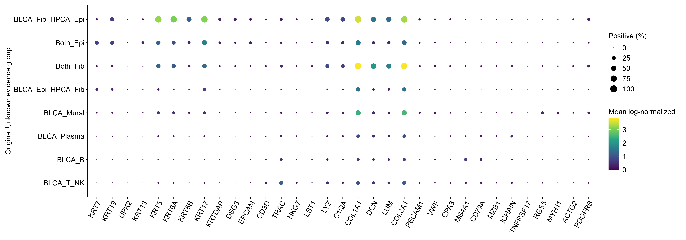
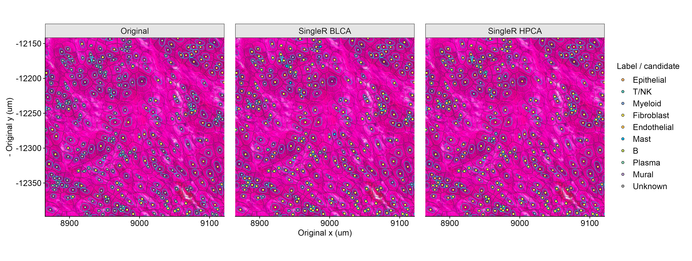

## 表达与空间复核记录（实际打开图像检查）

已查看两片各自全片候选空间图、既有UMAP、stroma / small_nuclei / edge / far_UMI_hotspot四个固定ROI的三路同坐标叠图，以及定向marker图。图中青色线为原核轮廓，灰线为8um归属区域；只有圆点填色代表注释/候选。ROI名称沿用原流程，不将名称本身当作病理真值。

**Cervilla：** stroma内可见细长核和邻近较大核对象；原Unknown有192/273，候选一致110、不同82。BLCA给出的73个Mural候选在HPCA中没有对等类别，不能据HPCA偏Fibroblast就把Mural并回Fibroblast。edge为组织/腔隙边界，Epithelial候选大致沿组织分布；89个原Unknown中74个两路一致，但该ROI nFeature中位数仅79，不因此宣布准确。small_nuclei有248/284个原Unknown，141个候选一致、105个不同，整体nFeature中位数50，仍需谨慎。far_UMI_hotspot混合了上皮和间质候选，nFeature中位数1210.5；其差异不能只归因于低深度。全片右侧浅蓝覆盖区域没有supplied bins，继续不赋予候选细胞身份。

Cervilla原Unknown的BLCA Epithelial候选22,393个、Fibroblast候选11,458个，其中分别14,323和8,689个检出至少两枚对应panel marker；群体均值/检测率显示KRT7/KRT19/KRT13与COL1A1/COL3A1等程序支持，但共存也明显：即使两路均为Epithelial的19,357个原Unknown中，9,049个同时检出≥2上皮与≥2成纤维marker。因此“两个方法一致”仍不是纯谱系证据。BLCA B候选920个中877个未检出任何B panel marker，nFeature中位数17，不宜直接采纳。Mural候选7,557个中只有911个检出≥2 Mural panel marker，应保留候选及独立类别，继续评估。Plasma候选1,703个中1,441个缺原定义core marker；免疫球蛋白panel检出不能替代core支持。

**D1_Johnson：** stroma包含明显细长核、基质和较大多边形细胞相邻的结构；203/302个为原Unknown，其中98个两路不同，46个属于BLCA Fibroblast / HPCA Epithelial重点分歧组，适合下一轮局部核对原bin归属。small_nuclei可见密集小核带和邻近较大细胞区；646/780个原Unknown中335个两路不同，T/NK、B和Fibroblast候选组成随参考变化。不能用空间多数票消除这些差异。edge只有72个分析对象，原Unknown65个，nFeature中位数35；分歧38个，偏低信息、参考敏感，不能因候选变满而认为已解决。far_UMI_hotspot的原Unknown仅22/189，18个两路一致，候选以Epithelial为主且沿组织边界分布；此局部不能代表全片所有Unknown。

D1重点分歧组BLCA Fibroblast / HPCA Epithelial共16,523个原Unknown，22,877,286 UMI，nFeature中位数872；14,049个 (85.03%) 同一对象内共同检出≥2上皮与≥2成纤维marker，13,462个触发原竞争规则。其群体同时显示KRT5/KRT6A/KRT17及COL1A1/DCN/LUM/COL3A1表达。对象数主要落在原簇2 (4,708)、6 (3,406)、4 (2,838)、3 (2,686)；原簇2/6/4的marker表包含KRT5/KRT6A/KRT6B/KRT17、DSG3、KRTDAP等上皮程序，簇3则突出COL1A1/COL3A1。可优先评估这些上皮候选，并将高表达竞争对象作为局部归属复核对象；目前不能判定是实际细胞状态、环境/胞质混入、参考偏差或边界竞争各占多少，更不能据此做恶性或细亚群判断。

D1 BLCA B候选9,449个中6,536个无B panel支持，Mast候选2,327个中仅51个有≥2 Mast panel marker；Plasma候选5,552个中4,787个缺原core marker，均不宜批量采用。原簇marker表是经过阳性率/差异筛选的摘要：Cervilla簇7、D1簇9没有通过原筛选的表行，并不表示无表达；没有伪造其marker。

这些直接证据支持下一轮分开处理“低检测量导致缺支持”和“有足够信息但存在谱系竞争”。对重点交界做有界bin→cell复核有依据；对全部Unknown重新扩张或强制填充没有依据。本轮没有修改任何原正式标签、counts、QC、聚类或空间边界，也不宣称分类准确率提高。

